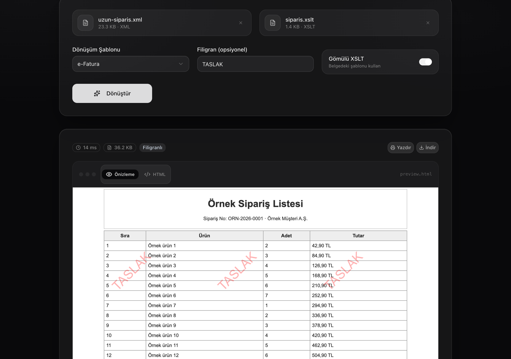
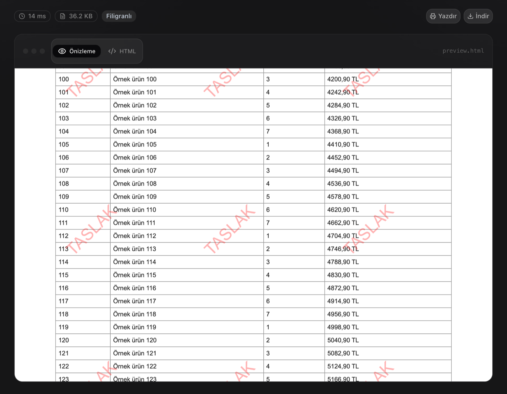
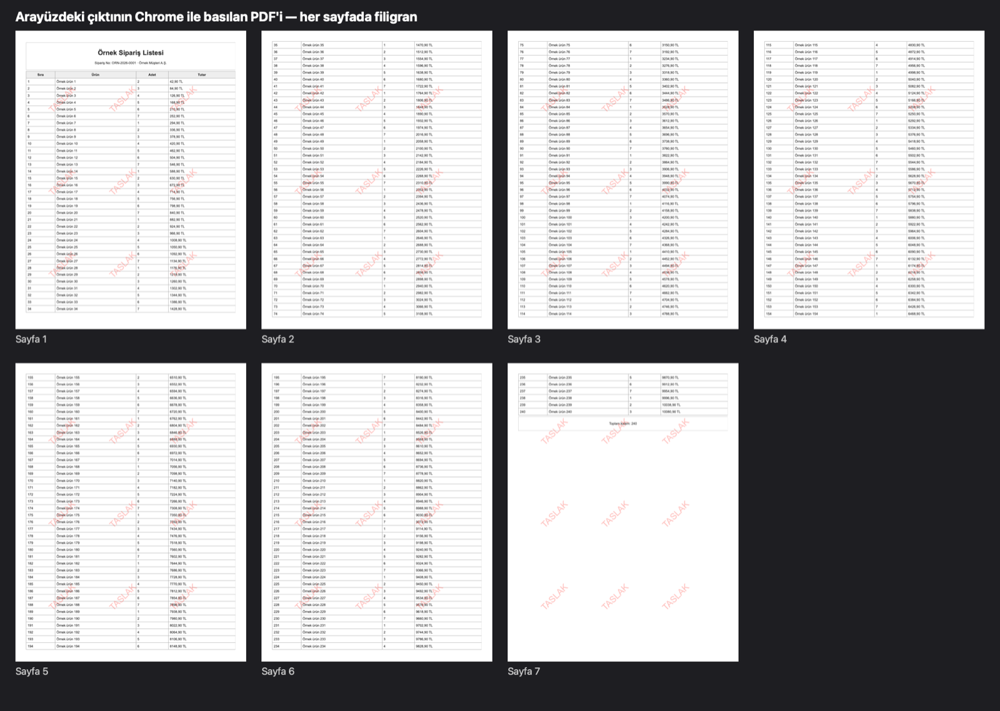
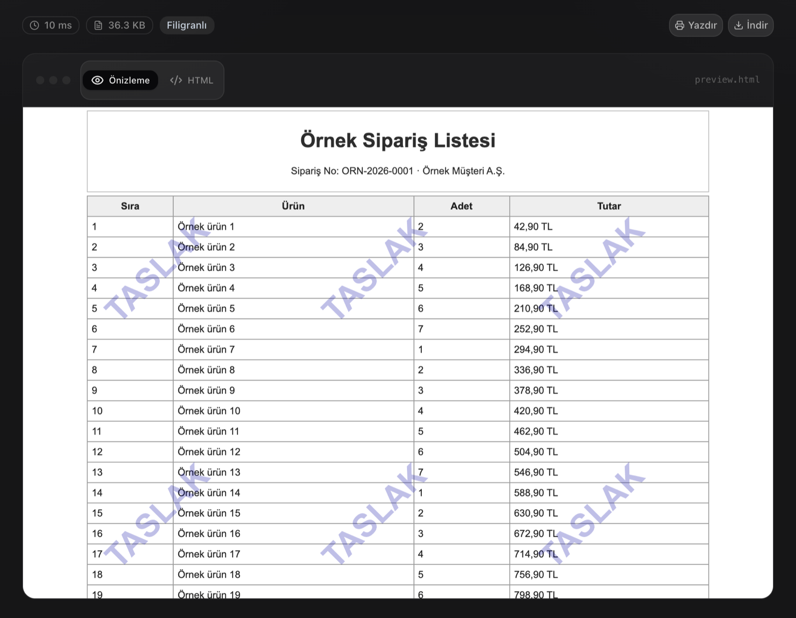
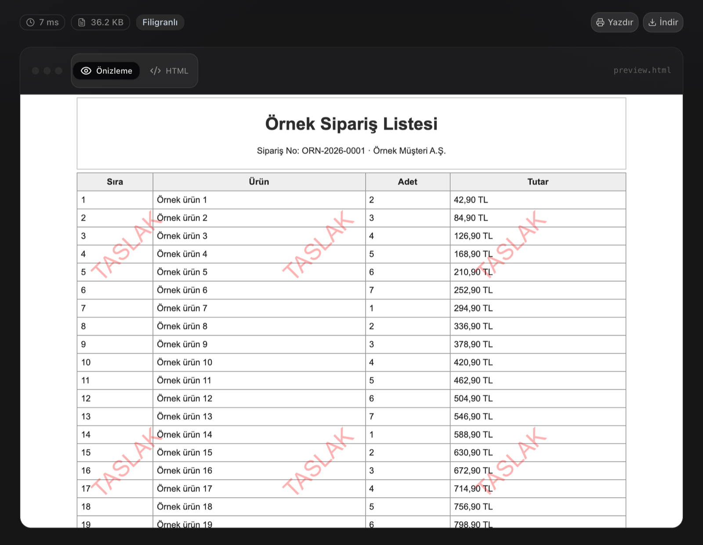
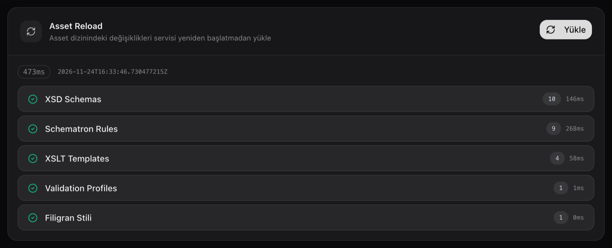
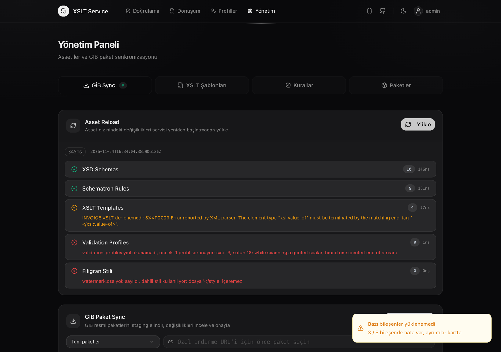

# Filigran Kullanım Kılavuzu

`/v1/transform` isteğinde `watermarkText` verilirse dönüştürülen HTML'e çapraz yazılmış bir filigran eklenir. Bu kılavuz filigranın nasıl istendiğini, nasıl göründüğünü ve görünümün kod değiştirmeden nasıl özelleştirildiğini anlatır.

- [Filigran isteme](#filigran-isteme)
- [Nasıl görünür](#nasıl-görünür)
- [Ayarlar](#ayarlar)
- [Görünümü özelleştirme](#görünümü-özelleştirme)
- [Tarifler](#tarifler)
- [Kurallar ve sınırlar](#kurallar-ve-sınırlar)
- [Sorun giderme](#sorun-giderme)
- [Ekran görüntüleri](#ekran-görüntüleri)

## Filigran isteme

**curl**

```bash
curl -X POST http://localhost:8080/v1/transform \
  -F "document=@fatura.xml" \
  -F "transformType=INVOICE" \
  -F "watermarkText=TASLAK" \
  -o fatura.html -D -
```

**.NET istemcisi**

```csharp
var result = await xsltClient.TransformAsync(new TransformRequest
{
    Document = xml,
    TransformType = TransformType.INVOICE,
    WatermarkText = "TASLAK"
}, ct);

// result.WatermarkApplied == true
```

**Web arayüzü:** Dönüşüm sayfasındaki "Filigran (opsiyonel)" alanı. Filigranlı çıktı önizlemede "Filigranlı" rozetiyle gösterilir.

**İstek ve yanıt kuralları**

- Metin en çok 200 karakter olabilir; daha uzunsa `400` döner. Boş ya da yalnız boşluktan oluşan metin filigran eklemez.
- Metin HTML'e kaçışlı yazılır; `<`, `>`, `&` ve `"` olduğu gibi görünür, etiket olarak yorumlanmaz.
- Yanıttaki `X-Xslt-Watermark-Applied: true` başlığı filigranın istendiğini bildirir.
- Filigran varsayılan, özel ve gömülü XSLT çıktılarının hepsine eklenir.

## Nasıl görünür

Filigran, belgenin tamamını kaplayan tek bir katmandır (`#watermark`):

- 300 px arayla dizilmiş 200 satır vardır. Her satırda 3 metin -45° döndürülmüştür ve %10, %39, %68 konumlarında durur.
- Renk `rgba(255, 0, 0, 0.3)`, yazı tipi 32 px Arial'dır.
- **Ekranda** katman belge yüksekliği kadardır ve belgeyle birlikte kayar.
- **Yazdırmada ve Chromium tabanlı PDF motorlarında** (Chrome'un yazdırma ve PDF çıktısıyla denendi) katman her sayfaya ayrıca basılır. Kısa son sayfalar ve tek sayfalık belgeler de filigran alır.
- Katman belgeye yer kaplamaz: sayfa sayısını, belge genişliğini ya da yüksekliğini değiştirmez. Tıklamaları da engellemez.
- XSLT tasarımındaki stiller katmanı etkilemez; katmanın kuralları id seçiciyle ve `!important` ile verilir.

## Ayarlar

Açılışta okunur; değiştirmek için servisi yeniden başlatın.

| Parametre | Env Variable | Varsayılan | Açıklama |
|-----------|-------------|------------|----------|
| `xslt.watermark.count` | `XSLT_WATERMARK_COUNT` | `3` | Satır başına metin sayısı. Konumlar sayıya göre hesaplanır |
| `xslt.watermark.rows` | `XSLT_WATERMARK_ROWS` | `200` | Satır sayısı (1–1000). Ekranda uzun belgelerin sonuna kadar filigran düşmesi buna bağlıdır; 200 satır 60.000 px, yani 40'tan fazla A4 sayfası eder |

```bash
docker run -p 8080:8080 \
  -e XSLT_WATERMARK_COUNT=2 \
  -e XSLT_WATERMARK_ROWS=400 \
  ghcr.io/mersel-os/ebelge-xslt-service:latest
```

Ayarlar ayrı bir YAML dosyasında da tutulabilir. `SPRING_CONFIG_ADDITIONAL_LOCATION` ile verilen dizindeki `application.yml` okunur:

```yaml
# config/application.yml
xslt:
  watermark:
    count: 2
    rows: 400
```

```bash
docker run -p 8080:8080 \
  -v $(pwd)/config:/opt/config:ro \
  -e SPRING_CONFIG_ADDITIONAL_LOCATION=/opt/config/ \
  ghcr.io/mersel-os/ebelge-xslt-service:latest
```

## Görünümü özelleştirme

Asset dizininin (`XSLT_ASSETS_EXTERNAL_PATH`) **köküne** `watermark.css` adlı bir dosya koyun:

```
custom-assets/
├── default_transformers/
├── validator/
├── validation-profiles.yml
└── watermark.css
```

Dosya dahili stilden **sonra** eklenir. Bir değeri değiştirmek için aynı seçiciyi `!important` ile yazın; dosyaya yalnız değiştirmek istediğiniz kuralları koyun:

```css
#watermark > div > div {
    color: rgba(0, 0, 160, 0.25) !important;
    font-size: 40px !important;
}
```

Başlangıç için yorumlu örnek dosya: [`custom-assets.example/watermark.css.example`](../custom-assets.example/watermark.css.example).

### Katman yapısı

| Seçici | Öğe | Dahili değerler |
|--------|-----|-----------------|
| `#watermark` | Katman | Ekranda `position: absolute`, baskıda `position: fixed`; `top/right/bottom/left: 0`, `overflow: hidden` |
| `#watermark > div` | Satır | `height: 300px` |
| `#watermark > div > div` | Metin | `top: 240px`, `rotate(-45deg)` (`transform-origin: left top`), 32 px Arial, `rgba(255, 0, 0, 0.3)` |
| `#watermark > div > div:nth-child(n)` | n. metnin yatay konumu | `left: 10%`, `39%`, `68%` |

Bu yapı sabittir; HTML'in kendisi özelleştirilemez, yalnız stili değiştirilir.

### Açılışta yükleme

Dosya servis açılırken okunur. Asset dizinini bağlayın:

```bash
docker run -p 8080:8080 \
  -v $(pwd)/custom-assets:/opt/xslt-assets \
  -e XSLT_ASSETS_EXTERNAL_PATH=/opt/xslt-assets \
  ghcr.io/mersel-os/ebelge-xslt-service:latest
```

Log'da şu satırlar görünür:

```
i.m.s.x.i.WatermarkService - Özel filigran stili yüklendi: watermark.css (103 karakter)
i.m.s.x.infrastructure.AssetRegistry -     ✓ Filigran Stili — 1 öğe yüklendi (3 ms)
```

> **Otomatik GİB sync ile birlikte kullanırken:** servis GİB paketlerini açılışta yalnız asset dizini **tamamen boşsa** indirir. İçinde yalnız `watermark.css` olan yeni bir dizin bağlarsanız dizin boş sayılmaz ve paketler inmez. Bu durumda paketleri `POST /v1/admin/packages/sync` ile indirin ya da `watermark.css`'i ilk açılıştan sonra ekleyin. Otomatik sync sürerken elle tetiklenen reload `Reload already in progress` döner; sync bitince tekrar deneyin.

### Sonradan ekleme ya da değiştirme

Servisi yeniden başlatmanız gerekmez. Dört yol var:

1. **Dosya izleme** (varsayılan açık, `XSLT_ASSETS_WATCH_ENABLED=true`): dosyayı bağlı dizine koyun ya da değiştirin. Değişiklik bir iki saniye içinde uygulanır.
2. **Çalışan konteynere kopyalama:** dizin bağlı değilse ya da Docker Compose'daki gibi adlandırılmış birim kullanılıyorsa:
   ```bash
   docker cp watermark.css <konteyner>:/opt/xslt-assets/watermark.css
   # Docker Compose ile
   docker compose cp watermark.css xslt-service:/opt/xslt-assets/watermark.css
   ```
3. **Yönetim paneli:** web arayüzünde *Yönetim → GİB Sync → Asset Reload → Yükle*. Her bileşen durumuyla listelenir; "Filigran Stili" satırında yüklenen dosya sayısı, hata varsa nedeni görünür.
4. **Elle yeniden yükleme (API)** (dosya izleme kapalıysa ya da betikten çağırmak için):
   ```bash
   TOKEN=$(curl -s -X POST http://localhost:8080/v1/auth/login \
     -H 'Content-Type: application/json' \
     -d '{"username":"admin","password":"<parola>"}' | jq -r .token)

   curl -s -X POST http://localhost:8080/v1/admin/assets/reload \
     -H "Authorization: Bearer $TOKEN" | jq '.components[] | select(.name == "Filigran Stili")'
   ```
   ```json
   { "name": "Filigran Stili", "status": "OK", "count": 1, "durationMs": 2, "errors": [] }
   ```
   `count: 1` özel stilin yüklendiğini, `count: 0` dosyanın olmadığını gösterir. `status: "FAILED"` olduğunda neden `errors` içindedir.

**Özel stili kaldırmak:** dosyayı silin ve elle yeniden yükleyin ya da dosyanın içeriğini boşaltın; ikisinde de dahili görünüme dönülür. Docker Desktop (macOS, Windows) ile bağlanan dizinlerde ana makinede yapılan silme konteynere dosya olayı olarak ulaşmayabilir. Bu durumda dosya izleyici silmeyi görmez ve eski stil yeniden yüklenene kadar kullanılmaya devam eder. Dosyayı boşaltmak ise bir değişiklik olayı olarak algılanır.

### Kurumunuza özel stili nerede tutmalı

`watermark.css` kurumunuza ait bir tasarımsa onu bu depoya değil, kendi yapılandırma deponuza ya da biriminize koyun. Asset dizinini oradan bağlayın ya da dosyayı oradan kopyalayın. `custom-assets/` dizini bu deponun `.gitignore` dosyasındadır.

## Tarifler

Aşağıdaki kurallar `watermark.css`'e eklenir. Hepsi Chrome baskısıyla denendi.

**Renk, boyut, kalınlık**

```css
#watermark > div > div {
    color: rgba(0, 0, 160, 0.25) !important;
    font-size: 40px !important;
    font-weight: bold !important;
}
```

**Açı** — eski WebKit motorları için `-webkit-` önekini de yazın:

```css
#watermark > div > div {
    -webkit-transform: rotate(-30deg) !important;
    transform: rotate(-30deg) !important;
}
```

**Daha sık satır** — satır yüksekliğini düşürün, metni satır içinde yukarı alın. 200 px satırla Chrome baskısında sayfa başına filigran sayısı 9'dan 15'e çıktı. Ekranda uzun belgelerde `XSLT_WATERMARK_ROWS` değerini de artırın (200 px × 200 satır = 40.000 px).

```css
#watermark > div { height: 200px !important; }
#watermark > div > div { top: 160px !important; }
```

**Metinlerin yatay konumu** — `XSLT_WATERMARK_COUNT` kaç ise o kadar `nth-child` kuralı yazın:

```css
#watermark > div > div:nth-child(1) { left: 5% !important; }
#watermark > div > div:nth-child(2) { left: 38% !important; }
#watermark > div > div:nth-child(3) { left: 71% !important; }
```

**Yalnız baskıda ve PDF'te göster** — ekran önizlemesinde gizler:

```css
@media screen {
    #watermark { display: none !important; }
}
```

## Kurallar ve sınırlar

- **Dosya:** UTF-8 olmalı (başındaki BOM atılır) ve en çok 64 KB olabilir. Yorumlar dahil hiçbir yerde style kapanış etiketi (`</style`) geçemez; geçerse stil bloğundan çıkıp HTML enjekte edilebilirdi.
- **Geçersiz dosya:** yok sayılır, dahili stil kullanılır, önceki geçerli özel stil de kaldırılır. Neden log'da ve reload sonucunda görünür.
- **Dosyanın yeri:** asset dizininin kökü. Dosya izleyici alt dizinleri yalnız açılışta kaydettiği için kök dizin seçildi; sonradan açılan bir alt dizindeki dosyayı görmezdi.
- **Görsel ve font:** yalnız `data:` URI kullanın. Dönüşüm yanıtının CSP'si dış fontları engeller. HTML'i doğrudan alan PDF motorlarında ise CSP hiç uygulanmaz; dış adresler belge her işlendiğinde çağrılır.
- **Boyut:** filigran HTML'i varsayılan ayarlarla "TASLAK" için yaklaşık 17 KB, 17 karakterlik bir metin için yaklaşık 25 KB büyütür. Artış satır ve metin sayısıyla doğru orantılıdır; `watermark.css` de her filigranlı yanıta eklenir.
- **Yerleşim:** katman için `html` öğesine `position: relative` verilir. Tasarımında ilk kapsayıcı bloğa göre konumlanan öğe (örneğin `position: absolute; bottom: 0`) olan şablonlarda bu öğe belgenin sonuna göre konumlanır.

## Sorun giderme

| Belirti | Olası neden | Ne yapmalı |
|---------|-------------|------------|
| Özel stil uygulanmıyor, log'da `Özel filigran stili yüklendi` yok | Dosya asset dizininin kökünde değil ya da adı farklı | Yol tam olarak `<XSLT_ASSETS_EXTERNAL_PATH>/watermark.css` olmalı |
| `watermark.css` ile açılan yeni kurulumda doğrulama ve varsayılan şablonlar yok | Dizin boş sayılmadığı için otomatik GİB sync çalışmadı | `POST /v1/admin/packages/sync` |
| Reload sonucu `FAILED`, hata `'</style' içeremez` | Dosyada (yorumlar dahil) style kapanış etiketi var | O diziyi kaldırın |
| Reload sonucu `FAILED`, hata `geçerli UTF-8 değil` ya da `bayttan büyük` | Dosya kodlaması ya da boyutu | UTF-8 ile kaydedin, 64 KB'ın altına indirin |
| Değişiklik uygulanmıyor | Dosya izleme kapalı ya da dosya bağlı dizinin dışında | Elle reload yapın; `XSLT_ASSETS_WATCH_ENABLED` değerini kontrol edin |
| Dosya silindi ama özel stil hâlâ uygulanıyor | Silme olayı konteynere ulaşmadı (Docker Desktop bağlı dizini) | Elle reload yapın; sonraki seferde dosyayı silmek yerine içeriğini boşaltın |
| Reload `Reload already in progress` dönüyor | Açılıştaki GİB sync ya da başka bir reload sürüyor | Birkaç saniye sonra tekrar deneyin |
| Kural yazıldı ama dahili değer değişmedi | `!important` eksik ya da seçici farklı | Aynı seçiciyi `!important` ile yazın |
| Ekranda çok kısa belgede filigran yok | Katman ekranda içerik yüksekliğinde biter; içerik ~100 px'ten kısaysa metinler kırpılır | Bilinen sınır; baskı ve PDF etkilenmez |
| Ekranda uzun belgenin sonlarında filigran yok | Satırlar belge sonuna yetmiyor | `XSLT_WATERMARK_ROWS` değerini artırın |
| `X-Xslt-Watermark-Applied: true` ama filigran yok | HTML'de `</body>` yok; filigran eklenemedi (log: `</body> etiketi bulunamadı`) | XSLT çıktısının `<body>` içerdiğinden emin olun |

## Ekran görüntüleri

Web arayüzünden alındı. Örnek veri: 240 kalemli bir sipariş listesi ve onu tabloya çeviren özel bir XSLT; filigran metni "TASLAK".

**Dönüşüm ekranı** — yüklenen dosyalar, filigran alanı, "Filigranlı" rozeti ve önizleme. Belgenin kendi `div { border; opacity }` stili filigrana sızmıyor.



**Önizlemede kaydırma** — önizleme 100.–123. satırlara kaydırıldı; filigran satırları belgeyle birlikte kayıyor.



**Yazdırma** — aynı çıktının Chrome ile basılan PDF'i. 7 sayfanın hepsinde filigran var; yalnız birkaç satır içeren son sayfa da tamamen kaplı.



**Özel stil** — servis çalışırken asset dizinine `watermark.css` (mavi, kalın, 40 px) eklendi. Dosya izleyici iki saniye içinde yükledi; yeniden başlatma gerekmedi.



**Geçersiz dosya** — `</style><script>…` içeren bir `watermark.css` reddedildi (`Filigran Stili — FAILED: dosya '</style' içeremez`). Dahili stil kullanıldı ve önizlemeye script girmedi.



**Yönetim panelinde reload** — *Yönetim → GİB Sync → Asset Reload*. Geçerli bir `watermark.css` ile "Filigran Stili" satırı `1` gösteriyor.



Aynı kartta hatalar: `</style>` içeren `watermark.css`, kapanmayan tırnaklı `validation-profiles.yml` ve bozuk bir varsayılan XSLT. Her bileşenin hatası kendi satırının altında görünüyor; bildirim "3 / 5 bileşende hata var" diyor.



